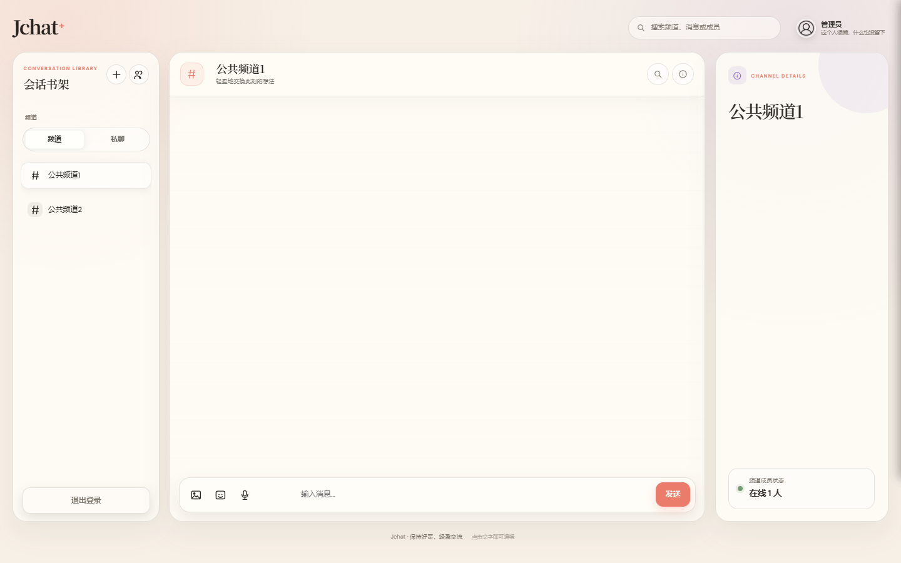
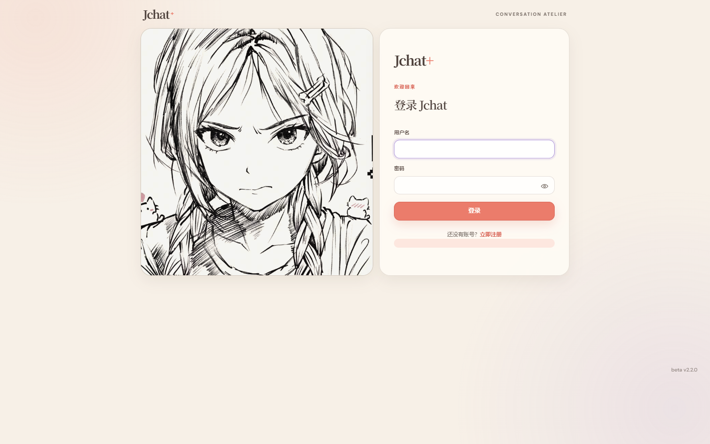
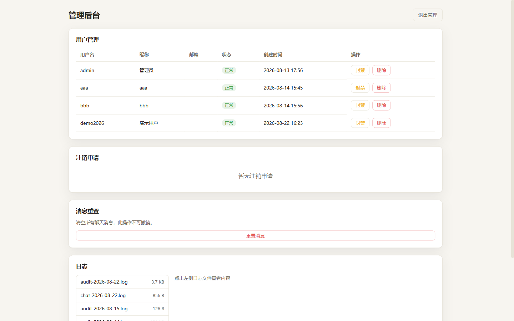

# Jchat-JoyChat

Jchat-JoyChat 是一个基于 Node.js、Socket.IO 与 SQLite 的实时聊天应用，包含公共和私有频道、好友私聊、在线状态、媒体消息与管理后台。

> 当前版本：`v2.2.0`。运行时使用 Node.js 24 LTS（`>=24 <25`）与 npm 11。

本轮安全、依赖与部署优化详见 [CHANGELOG.md](CHANGELOG.md)。

## 页面预览

### 聊天界面



<details>
<summary>查看更多页面</summary>

### 登录界面



### 管理后台



</details>

## 主要功能

- 实时频道聊天、私有频道成员控制与好友私聊。
- 图片、语音、Bilibili 链接与自定义表情包。
- JWT 会话、单会话登录、在线状态、撤回与回复。
- SQLite 持久化、私聊 AES-256-GCM 加密、管理后台与日志审计。

## 快速开始

### 环境要求

- Node.js 24 LTS（`>=24 <25`；仓库 `.nvmrc` 为 `24`）
- npm 11
- Windows、macOS 或 Linux

### 安装与启动

```bash
git clone https://github.com/Jov3c/Jchat.git
cd Jchat-JoyChat
npm install
npm start
```

Jchat-JoyChat 使用单一 Node.js 服务：聊天页面、登录、后台、API 和 Socket.IO 都由 `http://localhost:3000` 提供。后台地址为 `http://localhost:3000/admin`。

> `.env.example` 只是模板。项目读取的是**启动进程环境变量**，不会自动加载 `.env`；请使用 shell、服务管理器、容器编排或受控的环境加载器注入配置。

## 环境变量

| 变量 | 代码默认值 | 说明 |
| --- | --- | --- |
| `NODE_ENV` | 未设置 | 生产部署必须为 `production`。 |
| `PORT` | `3000` | 网页、API 与 Socket.IO 统一服务端口。 |
| `JWT_SECRET` | 开发占位符 | 生产环境必须是至少 32 字符的非默认密钥。 |
| `JWT_EXPIRES_IN` | `30d` | JWT 有效期。 |
| `DM_ENCRYPTION_KEY` | 开发回退（非生产） | 64 位 hex，或至少 32 UTF-8 字节的高强度字符串；生产环境必填。 |
| `ADMIN_USERNAME` | `admin` | 首次初始化的管理员用户名。 |
| `ADMIN_PASSWORD` | `admin123`（仅本地回退） | 首次初始化的管理员密码；生产环境至少 12 字符且不能是默认值。 |
| `JCHAT_ADMIN_CREDENTIALS_FILE` | `server/data/admin_credentials.json` | 管理员 bcrypt 凭据文件路径。 |
| `JCHAT_DB_FILE` | `server/data/jchat.sqlite` | SQLite 数据库路径。 |
| `JCHAT_UPLOADS_DIR` | `public/uploads/` | 仅 `npm run reset-data` 使用的上传目录覆盖项。 |
| `JCHAT_ALLOWED_ORIGINS` | 空 | 逗号分隔的精确 CORS 来源；生产环境请仅配置 HTTPS 域名。 |
| `JCHAT_TRUST_PROXY` | 未设置 | 仅部署在受信任反向代理后设置；可为 `true` 或 Express trust-proxy 值。 |
| `JCHAT_JSON_LIMIT` | `1mb` | JSON 请求体上限。 |
| `JCHAT_URLENCODED_LIMIT` | `100kb` | URL encoded 请求体上限。 |
| `JCHAT_URLENCODED_PARAMETER_LIMIT` | `1000` | URL encoded 参数数量上限。 |
| `JCHAT_RATE_LIMIT_WINDOW_MS` | `900000` | 所有限流器窗口，单位 ms（15 分钟）。 |
| `JCHAT_AUTH_RATE_LIMIT_MAX` | `10` | 登录限流阈值/每 IP/窗口。 |
| `JCHAT_REGISTRATION_RATE_LIMIT_MAX` | `20` | 注册限流阈值/每 IP/窗口。 |
| `JCHAT_ADMIN_RATE_LIMIT_MAX` | `5` | 管理员登录限流阈值/每 IP/窗口。 |
| `JCHAT_UPLOAD_RATE_LIMIT_MAX` | `30` | 上传限流阈值/每 IP/窗口。 |
| `JCHAT_SOCKET_MAX_HTTP_BUFFER_SIZE` | `1000000` | Socket.IO HTTP 缓冲上限，单位字节。 |
| `JCHAT_SOCKET_CONNECT_TIMEOUT_MS` | `20000` | Socket.IO 连接超时，单位 ms。 |
| `JCHAT_SOCKET_PING_TIMEOUT_MS` | `20000` | Socket.IO ping 超时，单位 ms。 |
| `JCHAT_SOCKET_PING_INTERVAL_MS` | `25000` | Socket.IO ping 间隔，单位 ms。 |
| `JCHAT_LOG_DIR` | `server/logs` | 日志目录。 |
| `JCHAT_LOG_RETENTION_DAYS` | `30` | 日志保留天数（有效范围 1–3650）。 |
| `JCHAT_LOG_CHAT_CONTENT` | `false` | 仅设为 `true` 时记录聊天正文；默认仅保留长度和元数据。 |

生成私聊密钥：

```bash
node -e "console.log(require('crypto').randomBytes(32).toString('hex'))"
```

### 浏览器 API/Socket 配置

单服务部署不需要浏览器端地址配置；页面会自动使用当前地址的 API 和 Socket.IO。只有将页面部署到独立域名时，才需要在页面加载前设置 `API_ORIGIN`：

```html
<script>
  window.API_ORIGIN = 'https://api.example.com';
</script>
```

未设置 `API_ORIGIN` 时，浏览器始终使用页面同源地址。

## 生产部署安全清单

- [ ] 设置 `NODE_ENV=production`。
- [ ] 设置随机 `JWT_SECRET`（至少 32 字符）和独立 `DM_ENCRYPTION_KEY`，并妥善保管；更换 DM 密钥前先规划历史私聊迁移。
- [ ] 首次启动前设置 `ADMIN_PASSWORD` 为至少 12 字符的强密码；不要使用本地默认账号。
- [ ] 使用 HTTPS 反向代理，并在代理层限制公开端口；仅在受信任代理后设置 `JCHAT_TRUST_PROXY`。
- [ ] 使用 `JCHAT_ALLOWED_ORIGINS` 配置精确 HTTPS 域名，避免宽泛或通配符 CORS。
- [ ] 备份 SQLite 数据库、`public/uploads/`、管理员凭据文件和 DM 密钥；DM 密钥丢失会导致相应私聊无法恢复。
- [ ] 保持 `JCHAT_LOG_CHAT_CONTENT=false`，并按合规要求设置日志目录与保留天数。

旧版管理员凭据文件若保存的是明文 `password`，服务首次启动会自动迁移为 bcrypt hash，并以安全权限写回。开发默认账号 `admin/admin123` 仅用于本地首次启动或重置数据；绝不能用于生产。

## 常用命令

```bash
npm start            # 启动网页、API 和 Socket.IO
npm run dev          # 监听并重启单一服务
npm test             # 运行自动化测试
npm run reset-data   # 清空运行数据并恢复本地默认管理员
```

`reset-data` 会删除用户、频道、消息、好友关系和用户上传内容，同时将普通登录和后台登录的管理员账号统一恢复为 `admin/admin123`（开发环境）。运行前请先备份需要保留的数据。

## 项目结构

```text
Jchat/
├── public/              # 页面、样式、浏览器脚本与静态媒体
│   ├── uploads/         # 用户上传目录（不提交到 Git）
│   └── js/
├── server/              # SQLite、会话、加密、日志与校验模块
│   └── data/            # 运行时数据库与管理员凭据（不提交到 Git）
├── scripts/             # 数据重置脚本
├── tests/               # 自动化测试
├── docs/images/         # README 预览图
├── index.js             # API 与 Socket.IO 入口
└── package.json
```

## 数据、备份与测试

- 默认数据库：`server/data/jchat.sqlite`
- 默认上传目录：`public/uploads/`
- 测试命令：`npm test`
- 不要提交 `.env`、数据库、管理员凭据、日志或上传文件。

## License

MIT
